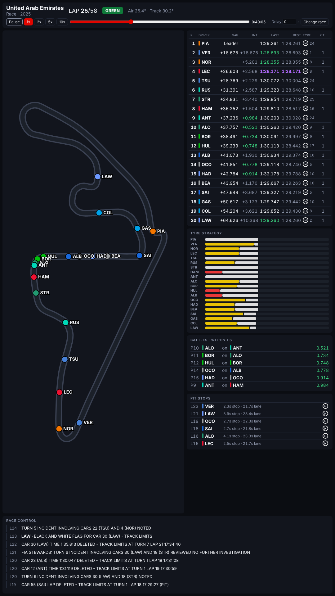

# F1 Telemetry Dashboard

A second-monitor dashboard of live Formula 1 race data from [OpenF1](https://openf1.org), meant to sit beside the race on F1 TV.



## What it does today (Phase 0)

- Pick any past session from 2023 onward and replay it at 1x, 2x, 5x or 10x, with a seek bar.
- Laid out for a portrait 1080x1920 monitor.
- Timing tower: position, gap to leader, interval (green inside 1 s), last and best lap (purple for fastest), tyre compound and age, pit stops.
- Tyre strategy chart, battles within 1 s, and a pit stop log.
- Track map: circuit outline traced from car positions and turned to stand tall, with cars drawn from a short buffer so they glide smoothly at every replay speed.
- Header with lap counter, track status (green, yellow, safety car, red, chequered) and weather.
- Race control feed: flags, penalties, incidents, newest first.
- Sync delay: hold the dashboard back N seconds to match your TV stream.

## Watching live (Phase 1)

Live data needs an [OpenF1 sponsor account](https://openf1.org) (EUR 9.90/month).

1. In this folder, copy `.env.example` to a new file named `.env` (in File Explorer: copy, paste, rename).
2. Open `.env` in Notepad and fill in the email and password of your OpenF1 sponsor account:

   ```
   OPENF1_USERNAME=you@example.com
   OPENF1_PASSWORD=your-openf1-password
   ```

3. Run `npm start`, open <http://localhost:8787>, and click **Go live** at the top of the session list. OpenF1's live window opens 30 minutes before each session.

The **F1 TV** button sets a 30 second delay as a starting point. Use **−1 / +1** until flags and overtakes appear on the dashboard at the same moment as on your TV. The setting is remembered.

## Insights (Phase 2)

- Gap to leader chart for the top 10 over the last 40 laps.
- Driver focus: click up to two drivers in the timing tower to see their speed, gear, throttle, brake, DRS and a 30 second speed trace.

## Race winner odds (Phase 3)

The **Race winner chance** panel shows each driver's chance of winning as priced by prediction markets: [Kalshi](https://kalshi.com/markets/kxf1race) first, [Polymarket](https://polymarket.com) when Kalshi has no market for the race. It lists the top six with their change over the last 10 minutes, and charts the top five over the session.

- Works in replays (price history for that session) and live (prices refreshed every 15 seconds and held back by the same sync delay as everything else, so they move with your TV picture).
- Read-only public market data: no account needed, nothing can place a bet. Prices are what traders are paying, not a prediction from this app.
- Kalshi usually opens a race's market a few days before the race. Before then the panel says no market was found.
- `npm run simulate` plays the 2025 Abu Dhabi race's real Kalshi prices along with the race, so you can see the panel move as it would live. Set `ODDS=off` in `.env` to turn odds off.

### Try live mode without a race

`npm run simulate` starts a local stand-in for OpenF1 that replays the 2025 Abu Dhabi GP as if it were live now, and starts the dashboard connected to it. Open <http://localhost:8787>. No OpenF1 account is needed.

## Run it on Windows

1. Install [Node.js](https://nodejs.org) 20 or newer (the LTS installer is fine).
2. Open PowerShell in this folder and run:

   ```powershell
   npm install
   npm start
   ```

3. Open <http://localhost:8787> in a browser on the second (portrait, 1080x1920) monitor and press F11 for full screen.
4. Pick a race. The first load of a race downloads it from OpenF1 (about a minute, because the free API allows 30 requests a minute). After that it is cached in `data/cache` and loads instantly.

To jump straight into a race: `npm start -- --session 9839` (2025 Abu Dhabi GP).

### Development

```powershell
npm run dev        # server with auto-reload + Vite dev server on http://localhost:5173
npm test           # server unit tests
npm run typecheck
```

Behind a corporate proxy, set `HTTPS_PROXY` and run with `NODE_USE_ENV_PROXY=1` (Node 22.21+) so the server can reach OpenF1.

## How it works

```
OpenF1 REST (history) ──► replay player ─┐
OpenF1 MQTT (live) ──────► live source ───┴─► sync delay ──► live store ──► WebSocket ──► React dashboard
```

- `server/src/openf1/client.ts` rate-limited REST client with a disk cache.
- `server/src/replay/` loads a session, merges every topic into one timeline, and plays it against the clock.
- `server/src/openf1/auth.ts` exchanges the sponsor login for a 1-hour token and renews it; `server/src/live/` is the MQTT feed.
- `server/src/pipeline/` sync-delay buffer and the latest-state store (new browser tabs get a snapshot).
- `server/src/odds/` finds the race-winner market on Kalshi or Polymarket, loads price history and polls live prices.
- `server/src/net/` WebSocket hub and HTTP server (serves the built web app).
- `web/src/` React + Zustand dashboard; car dots are interpolated at 60 fps between 3.7 Hz samples.

## Data and terms

Data comes from [OpenF1](https://openf1.org), an unofficial community project licensed CC BY-NC-SA 4.0 for non-commercial use. This project is not associated with Formula 1 or the FIA.
